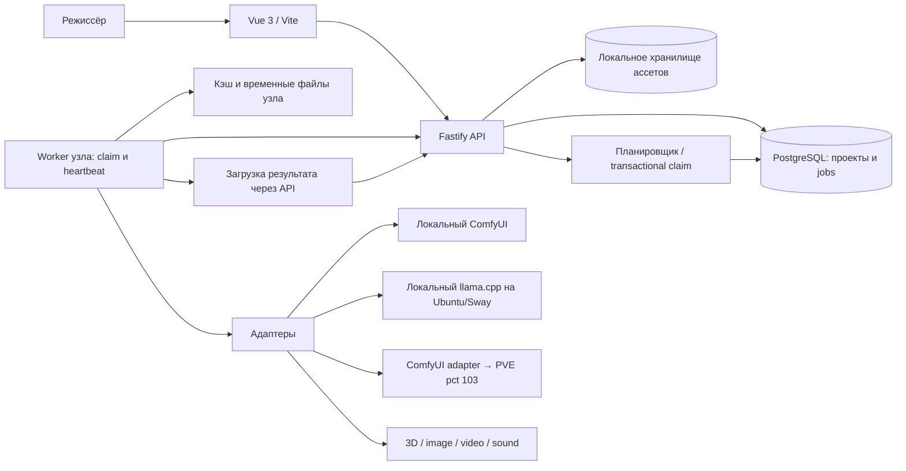

# Архитектура

## Выбор

Собственное ядро QwenDirector; [ADR-001](decision-records/ADR-001-architecture.md) описывает альтернативы. Node.js LTS + Fastify — практичный backend с единым языком DTO, асинхронными сетевыми адаптерами и отдельным процессом worker. CPU-тяжёлые операции выполняются вне API. Версии и совместимость ещё подлежат проверке; документ не является аудитом текущих библиотек.

PostgreSQL — единый источник истины для проектов, jobs, approvals, leases и audit. В MVP достаточно очереди в БД с транзакционным claim; Redis/BullMQ пока не нужны. Планировщик встроен в API, но использует блокировки БД, чтобы несколько экземпляров не назначали работу дважды. Worker обращается только к API, не к БД. Docker не является частью runtime-архитектуры: изоляцию дают PVE/PCT, systemd и отдельные worker-процессы.



## Границы и хранение

Domain ничего не знает о Fastify, файловых путях и ComfyUI node IDs. Contracts определяют JSON Schema и версии API; runtime-валидация обязательна на каждой границе. Web читает DTO, события и логические asset IDs. Адреса узлов, пути моделей и mapping workflow скрыты в исполнении.

Первое хранилище — диск координатора, байты по SHA-256, metadata в БД. Worker получает входы и загружает выходы через аутентифицированный API с проверкой размера/hash; общий NFS не обязателен. Локальные пути не передаются в UI. Upload идёт в staging; после hash-проверки выполняется atomic rename, затем транзакция связывает blob и AssetVersion. Незавершённые загрузки и осиротевшие blobs собираются по TTL с dry-run. Ссылки из БД нельзя удалять сборщиком.

После успешной fencing-проверки API сохраняет неизменяемый JSON manifest attempt вместе с SHA-256 его канонического представления в той же транзакции, что перевод Job в `succeeded`. Это фиксирует provenance до появления blob upload. `AssetVersion` создаётся только после staging, проверки hash и atomic promotion в content-addressed storage; manifest со staging descriptor сам по себе не считается ассетом.

## Исполнение

```mermaid
sequenceDiagram
  actor U as Режиссёр
  participant A as API / планировщик
  participant D as PostgreSQL
  participant W as Worker
  participant C as Адаптер / ComfyUI
  U->>A: Сохранить input snapshot и план
  A->>D: Job awaiting_approval + plan hash
  U->>A: Утвердить hash и лимит повторов
  A->>D: queued
  W->>A: Claim + capability snapshot
  A->>D: Транзакция: ресурс + lease + fencing token
  A-->>W: Attempt и неизменяемый план
  W->>C: Prepare / submit с attempt key
  C-->>W: External run ID
  W->>A: Сохранить run ID / running
  loop До завершения
    W->>A: Heartbeat attempt + progress
  end
  C-->>W: Выходные файлы
  W->>A: Upload staging + manifest + hashes
  A->>D: Проверка fencing и commit результата
  A-->>U: succeeded; ожидается утверждение варианта
```

## Состояния и надёжность

Job: `draft → awaiting_approval → queued → leased → running → succeeded | failed | cancelled`. Из `leased/running` при запросе отмены — `cancel_requested → cancelled`; из `queued` отмена немедленная. При потере lease — `reconciling`; после проверки исполнителя возможны `running` (новая контролируемая lease), `queued` (разрешённый безопасный повтор) или `needs_attention`. Изменение входов создаёт новый job, а не правит выполняющийся.

Claim блокирует строку job и строки устройств в одной транзакции (`FOR UPDATE SKIP LOCKED` для очереди плюс блокировка ресурсов), проверяет approval, capabilities и budget. Создаёт Attempt с монотонным fencing token. На первом этапе один активный job на GPU; дробное разделение VRAM не обещается. Длительные транзакции во время генерации запрещены.

Доставка как минимум однократная. `POST /v1/jobs` принимает idempotency key в пределах проекта: тот же key+payload hash возвращает прежний job, другой payload — conflict. Принятие результата возможно один раз для job и только с текущим attempt/token. Запоздалый результат после отмены или потери владения не становится принятым вариантом.

Worker хранит локальный журнал attempt key / external run ID. Crash между submit и записью ID требует lookup по correlation key. Если адаптер не умеет надёжный lookup, результат неизвестен: `needs_attention`, без слепого повторного запуска. Exactly-once выполнение сторонней системы не гарантируется.

Heartbeat узла и попытки — разные сообщения. Начальные dev-параметры: интервал 10 s, stale 30 s, lease 60 s; время определяет БД координатора. Потеря связи не доказывает остановку GPU-задачи: ресурс остаётся quarantined до reconcile или ручного решения. Worker после потери lease не начинает новых задач. Рестарт API восстанавливает состояние из БД; рестарт worker сверяет журнал и внешнюю очередь перед claim.

Cancel: сохраняется durable intent; worker вызывает адресную отмену и ждёт подтверждения. Если ComfyUI допускает только глобальный interrupt, отменять можно лишь на эксклюзивно принадлежащем worker экземпляре; иначе `needs_attention`. Ресурс освобождается после подтверждения остановки. При гонке success/cancel решает транзакция: уже принятый success остаётся success; сохранённый cancel запрещает commit success.

### H3 RefMod workflow

Для локального H3 I2V используется отдельный `refmod-i2v` boundary. Immutable profile закрепляет graph/hash, два RefMod names (vehicle и actor) и image-node bindings; job отдельно фиксирует исходные AssetVersion references, в том числе окружение и происхождение RefMod source sheets. Worker загружает парковочные кадры в ComfyUI, подставляет только `LoadImage` inputs и не заменяет ими tensor links `first_frame`/`last_frame`. Live preflight проверяет классы и RefMod inventory; создание job, ручное approval, leases, fencing и CAS commit остаются в общей очереди.

## Multi-node с первого дня

Node регистрируется выданным локально токеном: node ID, instance/boot ID, adapter versions, OS, GPU UUID, полная/свободная VRAM, модели с digest, workflows с digest, disk free и concurrency limits. Свободная VRAM — подсказка, не гарантия; prepare проверяет ресурс повторно. Неизвестная модель/workflow исключает узел из кандидатов.

Планировщик выбирает по modality, adapter/workflow version, model digest, памяти, диску, доступности и приоритету с aging. Нет подходящих ресурсов — job остаётся queued с объяснением. Внешние GPU-процессы могут нарушить оценку: OOM приводит к явной ошибке, уменьшение качества без нового плана запрещено. Два Proxmox-кластера — execution topology, а не автоматический кластер БД.

## API и безопасность

Планируемые маршруты: `/v1/projects`, `/scenes`, `/shots`, `/assets`, `/prompt-revisions`, `/jobs`, `/jobs/:id/approve`, `/jobs/:id/cancel`, `/nodes/register`, `/nodes/heartbeat`, `/worker/claim`, `/attempts/:id/heartbeat`, `/attempts/:id/complete`. Worker endpoints проверяют token и node ownership. UI получает события через SSE с event cursor и fallback polling; после reconnect перечитывает authoritative snapshot.

MVP слушает loopback, browser mutations проверяют Origin и сессию; удалённый доступ — через настроенный LAN TLS/VPN и авторизацию. Multi-node требует отдельных отзываемых node credentials. Секреты — ссылки на конфигурацию, не часть prompt/provenance. Модели, ассеты и текст не уходят наружу по умолчанию; внешнему адаптеру нужны enable flag и approval конкретного payload. Workflow считается исполняемым кодом: allowlist, проверка digest, запрет произвольных shell команд и URL fetch.

Для provenance сохраняются исходные revision IDs, hash плана, адаптер/version, workflow digest, model digest, seed (если поддерживается), фактические параметры, node/device, run ID, timestamps, output hashes и approvals. Отсутствующее значение помечается unknown; provenance не обещает битовую воспроизводимость GPU-генерации.
